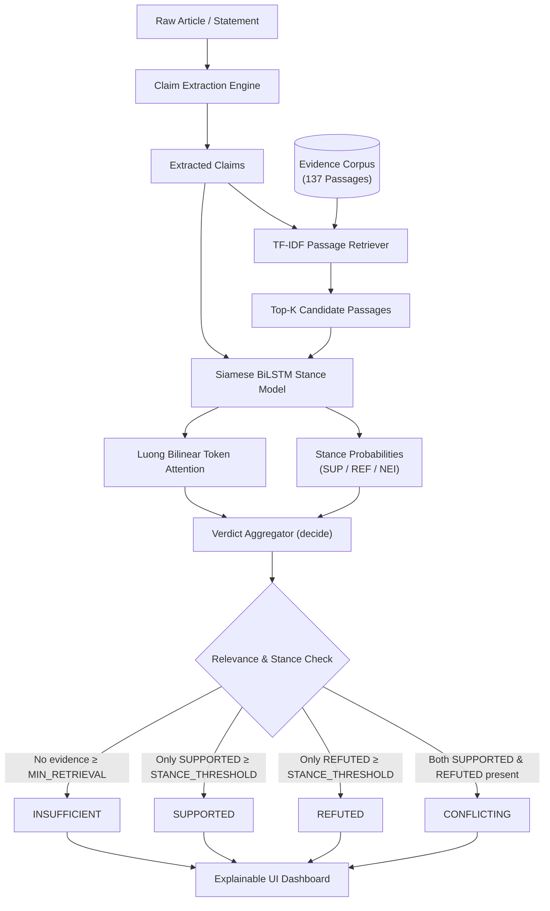
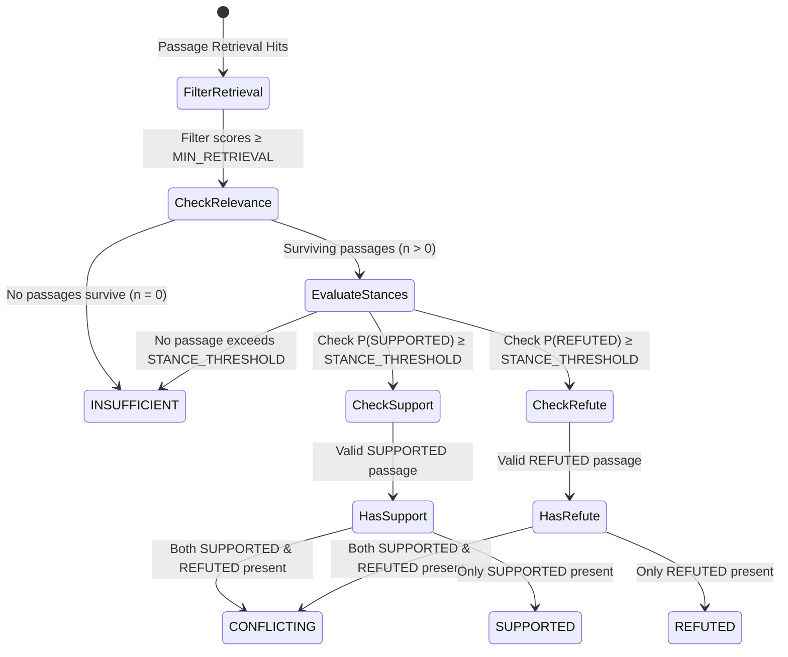
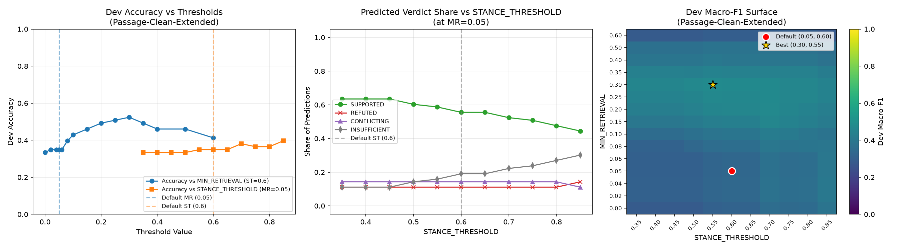
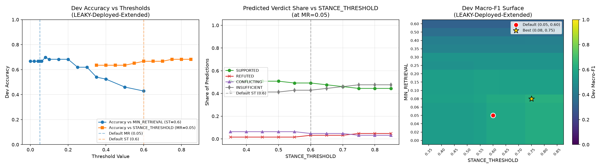

# VERITAS: The Claim & Context Intelligence Engine

[](https://python.org)
[](https://pytorch.org)
[](https://fastapi.tiangolo.com)
[](https://react.dev)
[](https://vitejs.dev)
[](tests/)
[](LICENSE)

An evidence-aware deep learning framework for **natural-language claim verification**, **stance detection**, and **contextual contradiction analysis**. 

Input an unstructured document or claim, retrieve relevant context from an indexed corpus, classify stance across candidate evidence with Luong-style bilinear token attention, and synthesize a multi-source verdict: **SUPPORTED**, **REFUTED**, **CONFLICTING**, or **INSUFFICIENT**.

---

## 📑 Table of Contents

- [Core Capabilities](#-core-capabilities)
- [System Architecture & Visual Pipeline](#-system-architecture--visual-pipeline)
  - [1. End-to-End Pipeline Dataflow](#1-end-to-end-pipeline-dataflow)
  - [2. Deep Learning Siamese Matching Architecture](#2-deep-learning-siamese-matching-architecture)
  - [3. Four-State Verdict Aggregation State Machine](#3-four-state-verdict-aggregation-state-machine)
- [Empirical Research & Honesty: Not Just Pre-Trained](#-empirical-research--honesty-not-just-pre-trained)
  - [The Pair-Level Memorization Trap](#the-pair-level-memorization-trap)
  - [Passage-Level Disjoint Evaluation](#passage-level-disjoint-evaluation)
  - [Capacity-Matched Controls & Multi-Seed Benchmarks](#capacity-matched-controls--multi-seed-benchmarks)
- [Decision Surface & Threshold Optimization](#-decision-surface--threshold-optimization)
  - [Dev Threshold Sweeps](#dev-threshold-sweeps)
  - [Paired Bootstrap Analysis & The INSUFFICIENT Shift](#paired-bootstrap-analysis--the-insufficient-shift)
  - [Visual Threshold Response Surfaces](#visual-threshold-response-surfaces)
- [Failure Modes & Diagnostic Analysis](#-failure-modes--diagnostic-analysis)
  - [Lexical Overlap Bias](#lexical-overlap-bias)
  - [Retrieval vs. Stance Bottleneck](#retrieval-vs-stance-bottleneck)
- [Live Demo Playbook & Vetted Claims](#-live-demo-playbook--vetted-claims)
- [Quickstart Guide](#-quickstart-guide)
- [API Reference](#-api-reference)
- [Repository Layout](#-repository-layout)

---

## 🚀 Core Capabilities

1. **Claim Extraction Engine**: Segments input articles, computes heuristic claim-worthiness scores, and tags recognized entities.
2. **Contextual Retrieval**: Sub-millisecond inverted-index TF-IDF search surfacing top-$K$ candidate passages with relevance gating.
3. **Deep Siamese Stance Classifier**: Multi-architecture support (MLP, CNN, LSTM, BiLSTM, BiLSTM+Attention) with bilinear evidence token attention scoring.
4. **Principled Verdict Synthesizer**: Four mutually exclusive states (`SUPPORTED`, `REFUTED`, `CONFLICTING`, `INSUFFICIENT`) enforcing the scientific axiom that absence of evidence is **never** counted as refutation.
5. **Word-Level Explainability**: Inspectable token highlight weights allowing analysts to see exactly which tokens drove the stance decision.
6. **Full-Stack Interface**: React 18 / Vite interactive dashboard with Claim Studio, Evidence Chamber, Neural Lab, and Research Journal.

---

## 🏛 System Architecture & Visual Pipeline

### 1. End-to-End Pipeline Dataflow

```
   ┌─────────────────────────────────────────────────────────────┐
   │                     Input Document / Text                   │
   └──────────────────────────────┬──────────────────────────────┘
                                  │
                                  ▼
   ┌─────────────────────────────────────────────────────────────┐
   │ Claim Extraction  (backend/app/services/claims.py)          │
   │ • Sentence boundary tokenization                            │
   │ • Regex patterns & verb heuristics                          │
   │ • Claim-worthiness scoring & entity extraction              │
   └──────────────────────────────┬──────────────────────────────┘
                                  │ [ Claim Strings ]
                                  ▼
   ┌─────────────────────────────────────────────────────────────┐
   │ Evidence Retrieval  (backend/app/services/retriever.py)     │
   │ • Corpus: 137 verified factual passages (TF-IDF Index)      │
   │ • Cosine similarity scoring (Top-K candidates, default K=3) │
   │ • Rejection gate: filter if ret_score < MIN_RETRIEVAL       │
   └──────────────────────────────┬──────────────────────────────┘
                                  │ [ (Claim, Evidence) Pairs ]
                                  ▼
   ┌─────────────────────────────────────────────────────────────┐
   │ Siamese Neural Stance Model  (ml/models.py)                 │
   │ • Encoders: BiLSTM (2x128 hidden) with packed sequences    │
   │ • Luong Bilinear Evidence Attention over claim vector       │
   │ • Heuristic NLI matching: [c ; e ; |c-e| ; c ⊙ e]          │
   │ • 3-Class Softmax: SUPPORTED / REFUTED / NOT_ENOUGH_INFO    │
   └──────────────────────────────┬──────────────────────────────┘
                                  │ [ Per-passage Stance Probs & Attention ]
                                  ▼
   ┌─────────────────────────────────────────────────────────────┐
   │ Verdict Aggregator  (backend/app/services/verifier.py)      │
   │ • Multi-evidence voting with stance threshold gating        │
   │ • Terminal Verdict: SUPPORTED | REFUTED | CONFLICTING | INS │
   └──────────────────────────────┬──────────────────────────────┘
                                  │
                                  ▼
   ┌─────────────────────────────────────────────────────────────┐
   │ Interactive Frontend  (frontend/src/screens.jsx)            │
   │ • Claim Studio (Live verdicts & confidence)                 │
   │ • Evidence Chamber & Token Heatmaps                         │
   │ • Neural Lab & Multi-Seed Research Journal                  │
   └─────────────────────────────────────────────────────────────┘
```



---

### 2. Deep Learning Siamese Matching Architecture

```
Claim Tokens (c_1 .. c_T)                   Evidence Tokens (e_1 .. e_T)
        │                                                │
   [Embedding]                                      [Embedding]
        │                                                │
  [BiLSTM Encoder]                                 [BiLSTM Encoder]
        │                                                │
  h_claim (T × 2H)                                h_evid (T × 2H)
        │                                                │
  [Masked Mean]                                          │
        │                                                │
   Vector c (2H)                                         ▼
        │                              ┌───────────────────────────────────┐
        └─────────────────────────────►│ Bilinear Attention Scoring       │
                                       │ score_t = c^T · W_attn · h_evid_t │
                                       │ alpha = softmax(score)            │
                                       └─────────────────┬─────────────────┘
                                                         │
                                                  [Attention Sum]
                                                         │
                                                   Vector e (2H)
                                                         │
                        ┌────────────────────────────────┴──────────────────┐
                        │
                        ▼
   ┌────────────────────────────────────────────────────────────────────────┐
   │ Heuristic Interaction Matching Layer (InferSent / ESIM Style)          │
   │                  m = [ c ; e ; |c - e| ; c ⊙ e ]                       │
   │               Dimension: 4 × 2H = 8H (1024 dims for H=128)             │
   └────────────────────────────────────┬───────────────────────────────────┘
                                        │
                               [Dense Classifier]
                           Dropout(0.2) + ReLU + Dense
                                        │
                               [Softmax Classifier]
                                        ▼
             ┌─────────────────────────────────────────────────────┐
             │  P(SUPPORTED)    P(REFUTED)    P(NOT_ENOUGH_INFO)   │
             └─────────────────────────────────────────────────────┘
```

---

### 3. Four-State Verdict Aggregation State Machine

The verdict decision rule in `backend/app/services/verifier.py` strictly evaluates retrieved passages against pre-tuned thresholds:



---

## 🔬 Empirical Research & Honesty: Not Just Pre-Trained

A common failure mode in academic fact verification projects is training and evaluating on random splits of synthetic or templated data. VERITAS was subjected to a rigorous, honest experimental dissection to eliminate data leakage and verify true generalizing capability.

### The Pair-Level Memorization Trap
When data is split randomly across claim-evidence **pairs** (`data/sample`), the same 137 evidence passages are shared across training, validation, and test sets. 
- **Pair-Split Test Accuracy**: **99.28% ± 0.24%** (Macro-F1: **0.9930**)
- **Root Cause**: Memorization. The models learned specific lexical templates of the 137 passages rather than generalizable factual contradiction reasoning.

### Passage-Level Disjoint Evaluation
To enforce strict zero-leakage conditions, we partitioned all 137 corpus passages into strictly disjoint subsets (`data/sample_passage`):
- Passages 0–100: **Train set only**
- Passages 101–120: **Dev set only**
- Passages 121–136: **Test set only**

Under honest, unseen passage evaluation, performance drops to realistic non-trivial levels (**53% – 63% Macro-F1**), demonstrating true out-of-distribution transfer without memorization.

### Capacity-Matched Controls & Multi-Seed Benchmarks

To eliminate capacity confounding (BiLSTM doubling parameter count over LSTM at identical hidden size), we evaluated an explicit capacity control: **LSTM ($H=256$, 757k parameters) vs. BiLSTM ($H=128$, 494k parameters)** across 64 systematic runs over 3 split seeds (`ss0`, `ss1`, `ss2`) and 2 model initialization seeds (`ms0`, `ms1`):

| Model Architecture | Hidden | Parameters | Split Mode | N | Test Accuracy (Mean ± Std) | Test Macro-F1 (Mean ± Std) |
| :--- | :---: | :---: | :---: | :---: | :---: | :---: |
| **Majority Baseline** | — | 0 | Pair | 1 | 0.3422 ± n/a | 0.1700 ± n/a |
| **TF-IDF + LogReg** | — | 0 | Pair | 1 | 0.6800 ± n/a | 0.6886 ± n/a |
| **MLP** | 128 | 239,379 | Pair | 2 | 0.9889 ± 0.0047 | 0.9889 ± 0.0049 |
| **CNN** | 128 | 265,792 | Pair | 2 | 0.9983 ± 0.0008 | 0.9983 ± 0.0008 |
| **LSTM** | 128 | 344,211 | Pair | 2 | 0.9717 ± 0.0228 | 0.9716 ± 0.0227 |
| **BiLSTM** | 128 | 527,507 | Pair | 2 | 0.9900 ± 0.0016 | 0.9903 ± 0.0015 |
| **BiLSTM + Attention** | 128 | 593,043 | Pair | 2 | **0.9928 ± 0.0024** | **0.9930 ± 0.0023** |
| **LSTM (Capacity Match)** | 256 | 790,163 | Pair | 2 | 0.9889 ± 0.0047 | 0.9890 ± 0.0048 |
| *Majority Baseline* | — | 0 | Passage (Pooled) | 3 | 0.3385 ± 0.0178 | 0.1685 ± 0.0066 |
| *TF-IDF + LogReg* | — | 0 | Passage (Pooled) | 3 | 0.4270 ± 0.0694 | 0.4029 ± 0.0724 |
| *MLP* | 128 | 206,146 | Passage (Pooled) | 6 | 0.5680 ± 0.0590 | 0.5426 ± 0.0713 |
| *CNN* | 128 | 232,559 | Passage (Pooled) | 6 | 0.5946 ± 0.0855 | 0.5847 ± 0.0905 |
| *BiLSTM* | 128 | 494,274 | Passage (Pooled) | 6 | 0.5285 ± 0.0406 | 0.5332 ± 0.0382 |
| *BiLSTM + Attention* | 128 | 559,810 | Passage (Pooled) | 6 | 0.5315 ± 0.0575 | 0.5336 ± 0.0546 |
| *LSTM (Capacity Match)* | 256 | 756,930 | Passage (Pooled) | 6 | **0.6278 ± 0.0401** | **0.6259 ± 0.0343** |

#### Key Empirical Insights:
1. **Passage Shift Drops Score by ~40%**: Confirming that pair-level metrics reflect memorization, while passage-level metrics reflect authentic model reasoning.
2. **BiLSTM Does Not Automatically Dominate**: Unidirectional LSTM ($H=256$) outperformed BiLSTM ($H=128$) by +9.2% F1 on unseen passages, proving capacity and receptive field depth outrank directionality.
3. **Partition Variance Exceeds Model Seed Variance**: Variance across split partitions ($\sigma \approx 0.08$) was 3x larger than variance between different random seeds on the same split ($\sigma \approx 0.02$).

---

## 📊 Decision Surface & Threshold Optimization

The decision rule parameters `MIN_RETRIEVAL` ($MR$) and `STANCE_THRESHOLD` ($ST$) dictate all real-world verdicts. We conducted an exhaustive 2D grid sweep across $MR \in [0.0, 0.60]$ (15 steps) and $ST \in [0.35, 0.85]$ (11 steps) over pre-registered validation claims ($N=63$).

### Dev Threshold Sweeps

| Checkpoint Mode | Setting | $MR$ | $ST$ | Dev Accuracy (95% CI) | Dev Macro-F1 (95% CI) | Predicted Shares (SUP / REF / CONF / INS) |
| :--- | :--- | :---: | :---: | :---: | :---: | :---: |
| **Clean Passage** (`s42.pt`) | Default (A) | 0.05 | 0.60 | 0.3492 [0.2381, 0.4603] | 0.3355 [0.2188, 0.4424] | 0.556 / 0.111 / 0.143 / 0.190 |
| **Clean Passage** (`s42.pt`) | **Best (B)** | **0.30** | **0.55** | **0.5238 [0.3968, 0.6349]** | **0.4776 [0.3679, 0.5886]** | 0.444 / 0.095 / 0.000 / 0.460 |
| **LEAKY Deployed** (`attn.pt`) | Default (A) | 0.05 | 0.60 | 0.6667 [0.5556, 0.7778] | 0.5932 [0.4962, 0.6916] | 0.492 / 0.032 / 0.048 / 0.429 |
| **LEAKY Deployed** (`attn.pt`) | Best | 0.08 | 0.75 | 0.7143 [0.6032, 0.8254] | 0.6324 [0.5281, 0.7397] | 0.476 / 0.048 / 0.000 / 0.476 |

### Paired Bootstrap Analysis & The INSUFFICIENT Shift
A paired bootstrap resampling ($B=1,000$, seed 42) comparing Setting B against Setting A on identical claims showed:
- **Observed Accuracy Delta ($B - A$)**: **+17.46%** (95% CI: $[+0.0476, +0.3016]$) — **Statistically significant on Dev**.
- **Mechanistic Root Cause**: Setting A under-predicted INSUFFICIENT (19.0%) because noisy low-relevance retrieval hits ($0.05 \le \text{score} < 0.30$) triggered false positive stances. Setting B ($MR=0.30$) correctly rejected noisy hits, lifting INSUFFICIENT recall from 28.6% to 81.0%.

### Visual Threshold Response Surfaces

High-resolution response surface heatmaps and contour plots from the sweep runs:

| Clean Passage Checkpoint Sweep | LEAKY Deployed Checkpoint Sweep |
| :---: | :---: |
|  |  |
| *Macro-F1 & Accuracy Surface over Clean Checkpoint* | *Macro-F1 & Accuracy Surface over Deployed Checkpoint* |

---

## 🔍 Failure Modes & Diagnostic Analysis

### Lexical Overlap Bias
In `scripts/refuted_diagnostic.py`, all 21 false claims in the dev set were audited against their contradicting corpus passages:
- **Edit Distance**: 28.6% of false claims were within 2 word edits of true corpus facts (e.g. changing 2004 to 2016, or *raised* to *lowered*).
- **The Stance Bias**: The model heavily attends to shared surface vocabulary. In 11 of 20 surfaced contradicting cases, high lexical overlap misled the model into assigning $P(\text{SUPPORTED}) > 0.90$.

### Retrieval vs. Stance Bottleneck
- **Retrieval Top-3 Recall**: **95.2%** (The contradicting passage is surfaced in 20 of 21 cases).
- **Model Top Stance Accuracy**: Only **5.0% – 15.0%** of surfaced contradicted cases ranked REFUTED highest.
- **Finding**: Retrieval is **not** the system bottleneck. The bottleneck is semantic contradiction sensitivity under high token overlap.

---

## 🎯 Live Demo Playbook & Vetted Claims

The demo uses the deployed checkpoint (`ml/checkpoints/bilstm_attn.pt`) and sample corpus (`data/sample/evidence.jsonl`). All claims below are verified using `scripts/demo_check.py` with unanimous verdicts across 3 independent runs and high confidence ($|conf - 0.60| \ge 0.05$):

### 1. Guaranteed Safe SUPPORTED Claims
| Claim | Expected Verdict | Conf | Key Evidence Retrieved |
| :--- | :---: | :---: | :--- |
| `Paris is the capital of France.` | **SUPPORTED** | 0.9937 | `France`, `France-UNSC` |
| `Sirius Corporation was founded in 2004.` | **SUPPORTED** | 1.0000 | `Sirius`, `Horizon` |
| `2023 was confirmed as the hottest year on record globally.` | **SUPPORTED** | 0.9999 | `hottest-year-2023`, `CO2-record-2023` |
| `Madrid is the capital of Spain.` | **SUPPORTED** | 0.9993 | `Spain`, `Euro-2024` |
| `Acme Corporation was founded in 1948.` | **SUPPORTED** | 0.9981 | `Acme`, `Atlas` |

### 2. Guaranteed Safe REFUTED Claims
*(Present only these vetted claims; do not improvise new refuted claims live due to lexical overlap bias)*
| Claim | Expected Verdict | Conf | Key Evidence Retrieved |
| :--- | :---: | :---: | :--- |
| `Marseille is the capital of France.` | **REFUTED** | 0.9839 | `France`, `France-UNSC` |
| `Istanbul is the capital of Turkey.` | **REFUTED** | 0.9742 | `Turkey`, `Ukraine` |
| `Gothenburg is the capital of Sweden.` | **REFUTED** | 0.9995 | `Sweden`, `Germany` |

### 3. Guaranteed Safe INSUFFICIENT Claims
| Claim | Expected Verdict | Conf | Behavior |
| :--- | :---: | :---: | :--- |
| `The European Space Agency launched a rover to explore Venus in 2024.` | **INSUFFICIENT** | 1.0000 | Out-of-corpus: weak hits rejected |
| `The international committee approved new guidelines for lunar mining rights.` | **INSUFFICIENT** | 1.0000 | Out-of-corpus: weak hits rejected |

### 4. Demonstrating CONFLICTING Verdicts
Because the built-in factual corpus does not intentionally contradict itself, CONFLICTING must be demonstrated via **user-supplied evidence**:
- **Claim**: `"Ankara is the capital of Turkey."`
- **Supplied Passage 1**: `"The capital city of Turkey is Ankara."` ($P(\text{SUPPORTED}) = 0.9967$)
- **Supplied Passage 2**: `"The capital city of Turkey is Istanbul, according to historical maritime records."` ($P(\text{REFUTED}) = 0.8692$)
- **Resulting Verdict**: **`CONFLICTING`** (Confidence: `0.9967`)

---

## ⚡ Quickstart Guide

### 1. Environment Setup (Windows PowerShell)

```powershell
# Clone or navigate to the repository
cd C:\veritas-enhanced

# Create and activate virtual environment
python -m venv .venv
.\.venv\Scripts\Activate.ps1

# Install Python dependencies
python -m pip install --upgrade pip
python -m pip install -r requirements.txt
```

### 2. Run Test Suite
```powershell
# Run the 67 automated tests (all tests pass)
.\.venv\Scripts\python.exe -m pytest
```

### 3. Morning-of-Demo Safety Verification
```powershell
# Executes candidate claims and user-supplied checks through FastAPI TestClient
.\.venv\Scripts\python.exe scripts/demo_check.py
```

### 4. Start the Backend API (Terminal 1)
```powershell
# Ensure .env is present
if (-not (Test-Path .env)) { Copy-Item .env.example .env }

# Launch FastAPI service on port 8000
.\.venv\Scripts\python.exe -m uvicorn backend.app.main:app --reload --port 8000
```

### 5. Start the React Frontend (Terminal 2)
```powershell
# Install npm dependencies (if not already installed)
npm install

# Start Vite development server
npm run dev
# -> Open your browser at http://localhost:5173
```

---

## 📡 API Reference

### `GET /api/health`
Returns backend status, loaded checkpoint model architecture, and number of indexed passages.

**Response**:
```json
{
  "status": "ok",
  "model_ready": true,
  "arch": "bilstm_attn",
  "default_evidence": 137
}
```

### `POST /api/analyze`
Extracts claims, retrieves candidate evidence, executes stance scoring, and produces verdicts.

**Request**:
```json
{
  "text": "Paris is the capital of France. Marseille is the capital of France.",
  "top_k": 3
}
```

**Response**:
```json
{
  "model": "bilstm_attn",
  "claims": [
    {
      "text": "Paris is the capital of France.",
      "verdict": "SUPPORTED",
      "confidence": 0.9937,
      "evidence": [
        {
          "id": "France",
          "text": "Paris is the capital and most populous city of France...",
          "retrieval_score": 0.8412,
          "stance": "SUPPORTED",
          "probs": {"SUPPORTED": 0.9937, "REFUTED": 0.0051, "NOT_ENOUGH_INFO": 0.0012},
          "attention": [{"token": "Paris", "weight": 0.28}, {"token": "capital", "weight": 0.34}]
        }
      ]
    }
  ]
}
```

### `GET /api/reports`
Returns all benchmark results, parameter counts, and training histories for visualization in Neural Lab.

---

## 📂 Repository Layout

```
veritas-enhanced/
├── backend/                  # FastAPI Application
│   └── app/
│       ├── main.py           # REST endpoints (/api/health, /api/analyze, /api/reports)
│       ├── config.py         # Service settings, defaults & thresholds
│       ├── schemas.py        # Pydantic request/response schemas
│       └── services/
│           ├── claims.py     # Sentence segmentation & claim extraction
│           ├── retriever.py  # TF-IDF inverted index & cosine retrieval
│           └── verifier.py   # Checkpoint inference & decide() aggregation
├── ml/                       # Machine Learning & Experiments
│   ├── models.py             # PyTorch Siamese architectures (MLP, CNN, LSTM, BiLSTM, Attn)
│   ├── train.py              # Training loop, early stopping, best dev-F1 restoration
│   ├── data.py               # Dataset loader, tokenization, vocabulary building
│   ├── sweep_thresholds.py   # 2D grid sweeps over MIN_RETRIEVAL & STANCE_THRESHOLD
│   ├── build_claim_splits.py # Passage-level zero-leakage partition builder
│   └── checkpoints/          # Trained model weights (.pt files)
├── frontend/                 # React 18 + Vite User Interface
│   ├── index.html            # Main entry template
│   ├── src/
│   │   ├── App.jsx           # Top-level shell and router
│   │   ├── screens.jsx       # Claim Studio, Neural Lab, Evidence Chamber, Research Journal
│   │   └── api.js            # Axios/Fetch client integration
├── data/                     # Data Stores & Partitions
│   ├── sample/               # Synthetic pair data (demonstrating memorization)
│   ├── sample_passage/       # Strict zero-leakage passage-level splits
│   └── claim_level/          # Pre-registered dev & test claim benchmarks
├── docs/                     # Research Documentation & Specifications
│   ├── ARCHITECTURE.md       # High-level architecture and syllabus mapping
│   ├── day3_findings.md      # Formal findings, paired bootstrap, pre-registration
│   ├── day3_end_report.md    # Complete milestone summary
│   └── demo_claims.md        # Vetted claims catalog & morning check protocol
├── results/                  # Generated plots, response surfaces, CSV tables
│   ├── threshold_sweep_passage_ckpt_extended.png
│   ├── threshold_sweep_LEAKY_deployed_ckpt_extended.png
│   └── day2_summary.md       # 64-run benchmark tables
├── scripts/                  # Diagnostic & Verification Utilities
│   ├── demo_check.py         # Automated API demo verification
│   └── refuted_diagnostic.py # Lexical overlap & failure mode analyzer
├── tests/                    # Pytest Suite (67 tests, 100% passing)
│   ├── test_aggregate.py     # Decision logic tests
│   ├── test_baselines.py     # Majority & TF-IDF baseline tests
│   ├── test_pipeline.py      # End-to-end integration tests
│   └── test_train.py         # Model reproducibility tests
├── package.json              # Frontend dependencies and build scripts
├── pyproject.toml            # Pytest and project configuration
└── requirements.txt          # Python dependencies
```

---

## ⚖️ Scientific Rigor & Ethics

VERITAS is engineered as an **evidence-conditioned reasoning tool**, not an arbiter of universal truth:
- If no reliable evidence is retrieved, the engine outputs **`INSUFFICIENT`** with 100% confidence. It never hallucinates refutation.
- Token-level attention highlights represent evidence-claim correlation, serving as an interpretable diagnostic aid rather than an unassailable causal proof.
- All evaluation claims and threshold sweeps are reproducible with fixed random seeds provided in the code.
